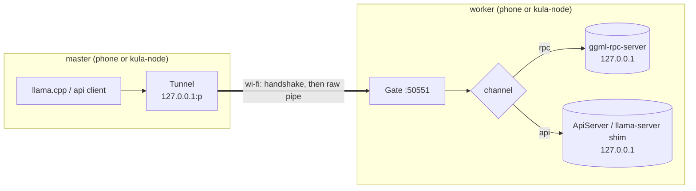
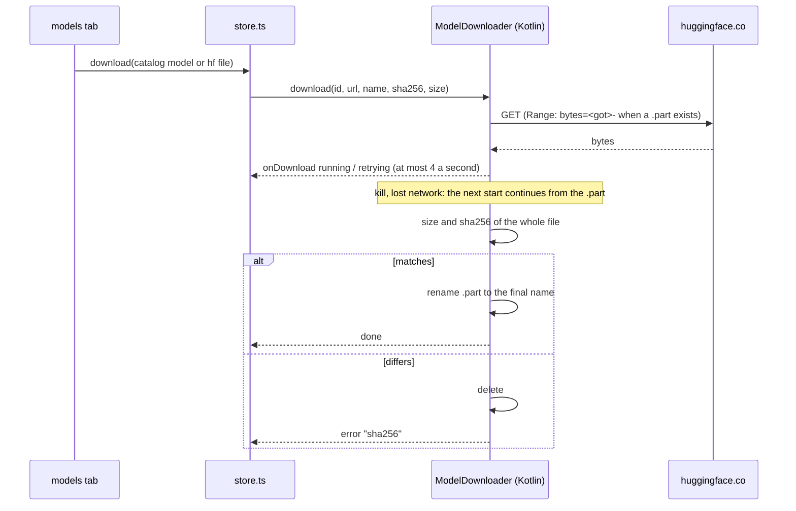
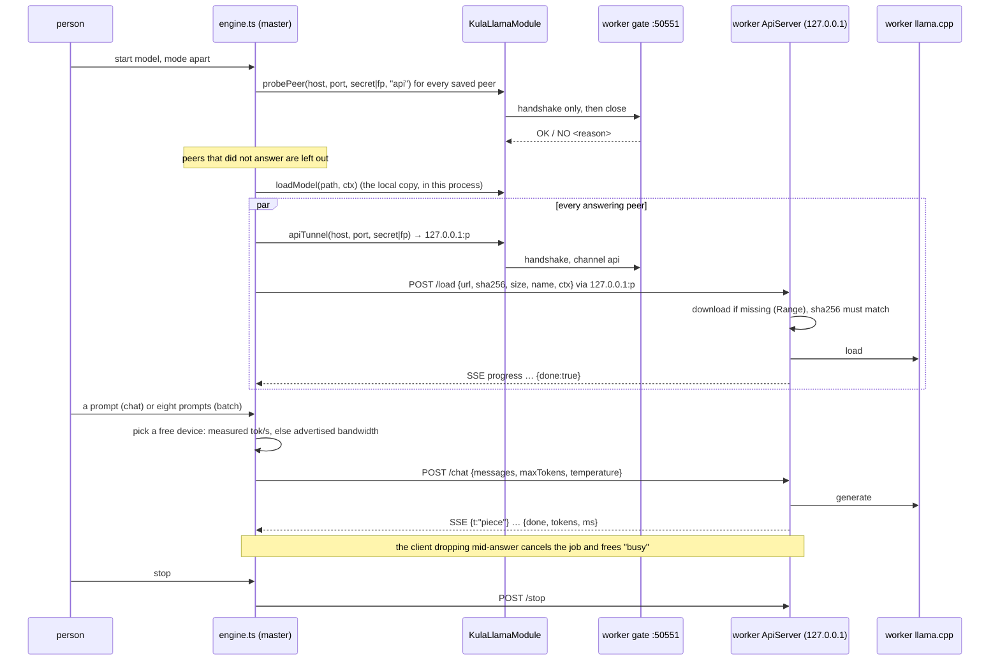
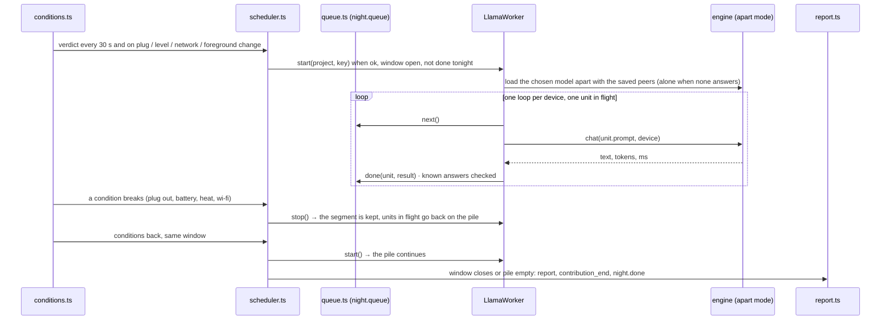

# architecture

How kula decentralized ai is put together: the pieces, the two processes on a phone, the way
data moves in each mode, the gate in front of everything, where files live, and why the
larger decisions were taken. The user side is in [GUIDE.en.md](GUIDE.en.md); the gate, the
auditor, the night and the computer client each have their own page ([GATE.md](GATE.md),
[AUDIT.md](AUDIT.md), [NIGHT.md](NIGHT.md), [NODE.md](NODE.md)). The decisions themselves were
logged, in Turkish, in [ILERLEME.md](ILERLEME.md).

Two sentences hold the whole thing. A phone lends its idle, charging hours to a project
by running a small language model; several phones (and computers) can be joined into one
local cluster. The rule the cluster follows is beyin's: **jobs are split, models are not**,
unless the devices are in the same room and the person asks for it.

## 1. components

```
kula-decentralized-ai/
├── app/                      the Expo app (Android first; iOS, web and Expo Go run without models)
│   ├── src/app/              routes: (tabs)/models, model/[id], chat, share, peers, together,
│   │                         (tabs)/passport, night/report, audit, settings, …
│   ├── src/llm/              catalog, fit, hf, store, peers, cluster (planner), engine, native, audit
│   ├── src/night/            conditions, scheduler, queue, jobs, LlamaWorker, SimulatedWorker, report
│   ├── src/passport/         the contract kula accepts from device-passport
│   └── modules/
│       ├── kula-llama/       the native module: llama.cpp b11157 + JNI + Kotlin (gate, worker, api, audit)
│       └── passport-measure/ the Expo bridge to device-passport's measurement (vendor/ is generated)
├── node/                     kula-node: a computer as worker or as the device that runs a cluster
│   └── relay/                kula-relay: a blind websocket pipe between two devices behind NAT
├── backend/                  the Supabase schema, the edge functions, the local dev server, the tests
├── web/                      the Mac passport script, a computer's passport page (pc/), the public config
├── tools/                    planner vectors shared by app and node, the docs link check, the mac script build
└── docs/                     this folder; the fork from afterhours is in HISTORY.md
```

| piece | language | what it does | entry points |
|---|---|---|---|
| app | TypeScript, Expo SDK 57, Expo Router | screens, the model catalog, the planner, the engine, the night | `app/src/app/`, `app/src/llm/engine.ts`, `app/src/night/useNight.ts` |
| kula-llama | C++ (llama.cpp, JNI), Kotlin | runs a model in-process, the worker process, the gate, downloads, the ledger | `android/src/main/cpp/kula_llama.cpp`, `KulaLlamaModule.kt`, `WorkerService.kt` |
| passport-measure | Kotlin (compiled from device-passport) | measures the phone: RAM, bandwidth, compute, thermal, battery | `PassportMeasureModule.kt`, `app/src/passport/contract.ts` |
| kula-node | TypeScript, Node 20+ | a computer behind the same gate; also a command-line master | `node/src/cli.ts` |
| backend | SQL, Node | accounts, projects, nights, the demo server | `backend/sql/`, `backend/tools/local-server.mjs` |

The native module is only ever present on Android arm64. In Expo Go, on iOS and on the web
`src/llm/native.ts` finds no module and the screens say so: the catalog is shown, nothing
downloads, the night falls back to the simulation.

### the app's JS layers (`app/src/llm/`)

| file | role |
|---|---|
| `native.ts` | a typed, logic-free wrapper over the Expo module (`info`, `download`, `loadModel`, `generate`, `probePeer`, `apiTunnel`, `startWorker`, `gateLedger`, …) |
| `catalog.ts` | the chosen GGUF models with size, sha256, license, context limit, KV cost per 1k tokens, and three-language blurbs; vision models also carry `mmproj` (the image encoder's file, size, sha256), see [NIGHT.md](NIGHT.md#photos-10112026) |
| `hf.ts` | Hugging Face search and file trees (size and sha256 from the LFS object), multi-part files, back-off on 429, gated and license info |
| `fit.ts` | does a model fit this phone, how fast would it go: file + KV + overhead against the passport's budget |
| `store.ts` | kv-store: local models, downloads in flight, settings, paired peers |
| `peers.ts` | the peer QR (v2 secret, v3 fingerprint + pin), reading and making it |
| `cluster.ts` | the split planner: probe every peer through the gate, share the layers by bandwidth, skip the dead |
| `engine.ts` | one model at a time in one of three modes; `chat`, `batch`, `load`, `unload`; `useEngine()` for screens |
| `audit.ts` | the ledger read in plain TS: parse, chain check, summary, a badge per peer |

### the Kotlin side (`app/modules/kula-llama/android/src/main/java/expo/modules/kulallama/`)

| file | role |
|---|---|
| `Native.kt` | the JNI surface of `libkula_llama.so`: load, generate, stop, serve (the RPC server), bandwidth |
| `KulaLlamaModule.kt` | the Expo module: everything JS calls, events `onToken`, `onDone`, `onDownload`, `onPeerFound`, `onPeerLost` |
| `Gate.kt`, `GateCert.kt` | the one open port: v1 HMAC handshake and v2 TLS between device certificates; the client side and the tunnel |
| `WorkerService.kt` | "share this phone": foreground service in the `:worker` process, the gate, NSD, status file, the auditor |
| `ApiServer.kt` | apart-mode HTTP API on 127.0.0.1: `/status`, `/load`, `/chat`, `/stop` |
| `ModelDownloader.kt` | resumable download (`Range`), sha256 at the end, `.part` until verified |
| `Discovery.kt` | browses `_kula._tcp` and resolves services for the peers screen |
| `audit/` | `Ledger`, `DeviceKey`, `Checks`, `Auditor`, `Json`, `B64`: beyin/check v0, plain Kotlin, JVM-testable |

llama.cpp itself is not in git: `tools/llama-src.mjs` fetches the pinned release, checks its
sha256 and applies the patches in `tools/patches/`. Gradle runs it before every build.

## 2. processes on a phone

Android keeps one model per process (llama.cpp's state is global). The app therefore runs
as two processes when the phone is shared:

```mermaid
flowchart LR
  subgraph app["app process (the master, or alone)"]
    UI[screens] --> ENG[engine.ts]
    ENG --> MOD[KulaLlamaModule]
    MOD --> LL1[(llama.cpp\nlocal model)]
    MOD --> TUN[tunnels to peers\n127.0.0.1:n]
  end
  subgraph worker[":worker process (share this phone)"]
    WS[WorkerService\nforeground, screen on, wake + wi-fi locks]
    WS --> GATE[Gate :50551\n0.0.0.0]
    GATE -- rpc --> RPC[(ggml-rpc-server\n127.0.0.1)]
    GATE -- api --> API[ApiServer\n127.0.0.1]
    API --> LL2[(llama.cpp\nworker model)]
    WS --> NSD[NSD _kula._tcp]
    WS --> LED[(beyin ledger\nfiles/beyin/ledger.jsonl)]
  end
  MOD -. status.json, startWorker/stopWorker .-> WS
```

- The **app process** holds the person's own model (alone or split, where it also holds the
  tunnels to the peers' RPC servers) and, in apart mode, the tunnels to the peers' APIs.
- The **`:worker` process** is started by "share this phone" and ends with it. ggml's RPC
  server loop cannot be stopped once started, so stopping the worker means ending the process.
  State goes back to the app through a JSON status file, polled every two seconds.
- The worker keeps the screen on while it runs: Android gives a background process only the
  slow cores, and llama.cpp threads wait for each other at every step, so a worker in the
  background drops to a tenth of its speed.
- Both processes share the device identity on disk (`files/gate/`, `files/kula_device_key`).

## 3. the gate and the tunnel

A kula device opens exactly one port, 50551. Behind it, on 127.0.0.1 only, sit ggml's RPC
server (split mode) and the HTTP API (apart mode). A master never addresses those directly:
it opens a local tunnel, the tunnel does the handshake through the gate, and from then on
the connection is a plain pipe. llama.cpp on the master is told `127.0.0.1:<tunnel port>`
and never sees the network.



Two protocols live on the port and the server tells them apart by the first byte: `K` is a
v1 hello (shared secret from a v2 QR, HMAC-SHA256 challenge), `0x16` is a TLS ClientHello
(v2: TLS 1.3 between self-signed device certificates, paired once with a one-time code from
a v3 QR). The full protocol, every refusal reason and the file layout are in [GATE.md](GATE.md).
With an auditor attached, every connection, refusal and end is written to the signed ledger
([AUDIT.md](AUDIT.md)).

## 4. data flows

### 4.1 downloading a model



Multi-part GGUFs are downloaded part by part under `<id>#<n>` and become one record when the
last part is verified; llama.cpp finds the siblings next to the first file.

### 4.2 alone

The model is loaded into the app process with the context the fit allows; `generate` streams
tokens through `onToken` and ends with `onDone`. Nothing crosses the network.

### 4.3 apart mode (the default when devices are joined)

Every device runs its own copy of the model; the work is handed out; the speeds add up.
This is how a night works and what kula-node's `chat --mode apart` does.



In apart mode the model file reaches the worker over the network: a phone worker downloads
it from the same URL the master used (Hugging Face); a kula-node master serves its own file
on a random path for the run. A worker refuses a file whose sha256 differs from what `/load`
asked for.

### 4.4 split mode (same room only)

One model, its layers spread over the devices with ggml's RPC backend. A bigger model than
any device holds alone, at the price of every token crossing wi-fi.

```mermaid
sequenceDiagram
  participant U as person
  participant E as engine.ts (master)
  participant P as cluster.ts planner
  participant N as KulaLlamaModule
  participant G as worker gate :50551
  participant R as worker ggml-rpc-server (127.0.0.1)
  U->>E: start model, mode split (= share it)
  E->>P: planSplit(model, peers, this phone's free RAM)
  P->>N: probePeer(…, "rpc") for every peer
  N->>G: handshake only
  G-->>N: OK / NO busy / NO <reason>
  P-->>E: used peers with MB each, skipped peers with reasons, local MB
  Note over P: need = file × 1.1; this phone may use 70 % of free RAM,<br/>a worker 75 % of what it advertised; fastest bandwidth filled first;<br/>"toobig" when even together it does not fit
  E->>N: loadModel(path, ctx, threads, peers[{host,port,secret|fp,weight}], localWeight)
  loop each used peer
    N->>N: open a tunnel 127.0.0.1:p, channel rpc
    N->>G: handshake
    G->>R: pipe (one master at a time; a second gets NO busy)
  end
  N->>N: llama.cpp: rpc_servers = 127.0.0.1:p1,…; tensor_split = local,w1,…
  Note over N,R: the layers stream to each worker's memory over its tunnel (the slow part)
  N-->>E: LoadResult {layers, localLayers, split[{buffer, mb}]}
  U->>E: a prompt
  E->>N: generate
  loop every token
    N->>R: forward pass over the tunnel(s)
  end
  N-->>E: onToken … onDone
```

The output layer stays on the master: the local share is the first entry of the tensor
split and llama.cpp keeps the last layers on the main device. llama.cpp aborts the whole
process on an RPC address that does not answer, which is why the planner probes first and
never hands a dead peer to the native side.

### 4.5 the night



Details, limits and the report's fields are in [NIGHT.md](NIGHT.md).

## 5. where files live

### on the phone (`/data/data/app.pasaport.android/files/`)

| path | what | written by |
|---|---|---|
| `models/<file>.gguf`, `models/<file>.gguf.part` | model files, a `.part` until verified | ModelDownloader |
| `beyin/ledger.jsonl`, `beyin/ledger.<t>.jsonl` | the signed, chained ledger, rotated at 5 MB | the worker's auditor |
| `kula_device_key` | the device key (algorithm, PKCS8, public key; one per line) | `DeviceKey` |
| `gate/gate_key`, `gate/gate_cert.der`, `gate/paired` | the P-256 gate key, its self-signed certificate, the pinned masters | `GateCert` |
| `kula_gate_ledger.jsonl` | the first, unsigned refusal log (before beyin) | Gate (older builds) |
| worker status file (JSON) | state, peer, held MB, connects, rejects, `fp`, `pin` | WorkerService |

kv-store keys (expo-sqlite, never sent): `llm.models`, `llm.peers`, `llm.settings`,
`llm.hfHistory`, `night.want`, `night.charge`, `night.minBattery`, `night.start`,
`night.queue`, `night.segments`, `night.reports`, `night.done`, `night.results`,
`night.project`, `passport.linked`.

### on a computer (`~/.kula-node/`, `KULA_NODE_HOME` overrides)

| path | what |
|---|---|
| `llama-b11157/` | llama.cpp binaries from `kula-node setup` (or `<repo>/.llama/host/` reused) |
| `models/` | models a master asked this computer to load |
| `peers.json` (mode 600) | the peer book of a computer that runs a cluster |
| `device_key.pem`, `gate_key.pem`, `gate_cert.der`, `paired` | identity and pairings |
| `ledger.jsonl` | the ledger, same format as the phone's |

### in the repository

| path | what |
|---|---|
| `app/modules/kula-llama/tools/gate-vectors.json`, `audit-vectors.json` | fixed vectors both implementations must reproduce; `node/test/` holds byte-identical copies |
| `app/modules/kula-llama/tools/dev-gate.mjs` | a gate on a Mac for testing without a second phone |
| `app/modules/kula-llama/tools/llama-src.mjs`, `tools/patches/` | the pinned llama.cpp and its patches |
| `app/modules/kula-llama/audit-jvm/` | a gradle project that runs the Kotlin tests without an Android SDK |
| `app/modules/passport-measure/vendor/` | generated snapshot of device-passport's core |
| `app/.env.production`, `app/.env.development.local` | which server a build talks to |
| `docs/shots/` | screenshots from the emulator-plus-Mac cluster runs |
| `web/passport/mac.sh` | the Mac passport script, generated by `tools/passport-mac.py` |
| `tools/planner-vectors.json` | planner vectors the phone's and kula-node's planners must both reproduce |

## 6. why it is this way

**The RPC server listens on 127.0.0.1 and nowhere else.** ggml's RPC server has no
authentication and its protocol lets a client write into the server's memory. It must never
be reachable from the network. The gate is the only listener, it does a handshake, and it
pipes to localhost. This holds in all three implementations (`Native.serve("127.0.0.1:…")`,
`ggml-rpc-server -H 127.0.0.1`, dev-gate) and the test suites check it.

**The worker is a separate process.** llama.cpp holds one model per process, and the RPC
server loop cannot be stopped once it runs. A worker in its own process can be killed
cleanly, cannot take the app down with it, and can serve while the app's own model is
loaded for the person.

**Downloads continue with `Range` and are kept only when the sha256 matches.** Phones get
killed mid-download; models are gigabytes. A `.part` that resumes saves the retry; a
checksum at the end is what makes a half-written or corrupted file impossible to load,
which was PrivateLM's most common support problem. The catalog carries the checksums from
the Hugging Face LFS objects, a search result carries them from the file tree, and a worker
in apart mode checks what it is asked to load.

**The sha256 is mandatory.** A model without a known checksum is not downloaded from the
catalog and a worker refuses a `/load` whose sha differs from what the master asked for.
The ledger's `load` line records both.

**Apart mode is the default when devices are joined.** Beyin's rule: jobs are split, models
are not. In apart mode a slow phone never holds a fast one back, a device that drops out
costs one unit, nothing but prompts and answers cross wi-fi, and the speeds add up. Split
mode exists for the one case it is good at, a model bigger than any single device, and the
app offers it only as an explicit choice because every token then crosses the network and
one dead peer stalls the whole model. Split is for the same room; apart works wherever the
gate is reachable.

**The gate is a shared port, not a shared library.** llama.cpp is unchanged apart from two
log lines. Everything kula adds sits in front of it, so the pinned release can move without
touching the security layer, and a PrivateLM worker could in principle join a cluster.

**The version is pinned.** ggml's RPC protocol only matches between identical builds.
b11157 everywhere (phones, kula-node, dev-gate), fetched by script, never edited by hand.

**beyin v0 only checks.** The auditor hands out no work, talks to no server and decides
nothing about routing. It writes what it saw to a signed, chained ledger, so that a future
beyin can score devices from evidence rather than from claims. Known-answer units in the
night are the first instance of the same idea.

**Pure functions wherever the behaviour matters.** The fit, the planner, the conditions, the
scheduler, the checks and the ledger parsing are all pure and tested with fake inputs (fake
clock, fake worker, fake fetch). The native and network code around them is thin.

**The measurement is not kula's.** The passport comes from device-passport's own code,
compiled in; kula only defines what it accepts (`src/passport/contract.ts`). Changing the
measurement means changing device-passport and syncing the snapshot.
